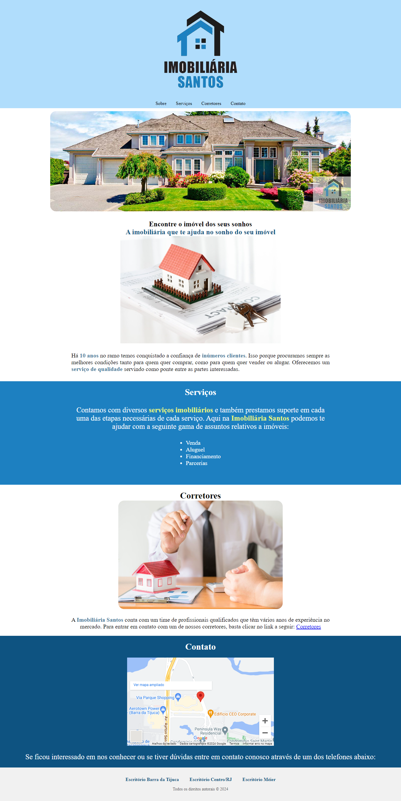

# Imobiliária Santos

Página de apresentação de uma imobiliária construída com HTML e CSS. Organiza informações institucionais, serviços, corretores e contato.



## Recursos

- Navegação por âncoras para as seções da página.
- Apresentação de venda, aluguel, financiamento e parcerias.
- Imagens de imóveis e equipe.
- Mapa incorporado pelo Google Maps.

## Como visualizar

```bash
git clone https://github.com/alvesvslucas/imobiliaria.git
cd imobiliaria
```

Abra `index.html` em um navegador. O mapa depende de conexão com a internet.

## Estrutura

- `index.html`: conteúdo da página.
- `style.css`: estilos.
- `assets/`: logotipo, fotografias e captura de demonstração.
- `LEIA-ME.md`: versão anterior da apresentação do projeto.

## Escopo

Demonstração de página institucional, sem catálogo dinâmico ou gestão de imóveis. Os links de corretores e escritórios usam `href="#"` e precisam de destinos reais para uso comercial.

